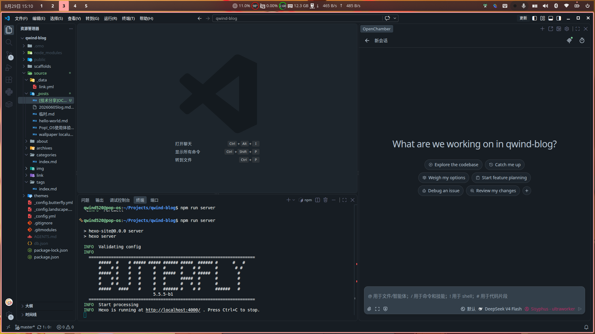
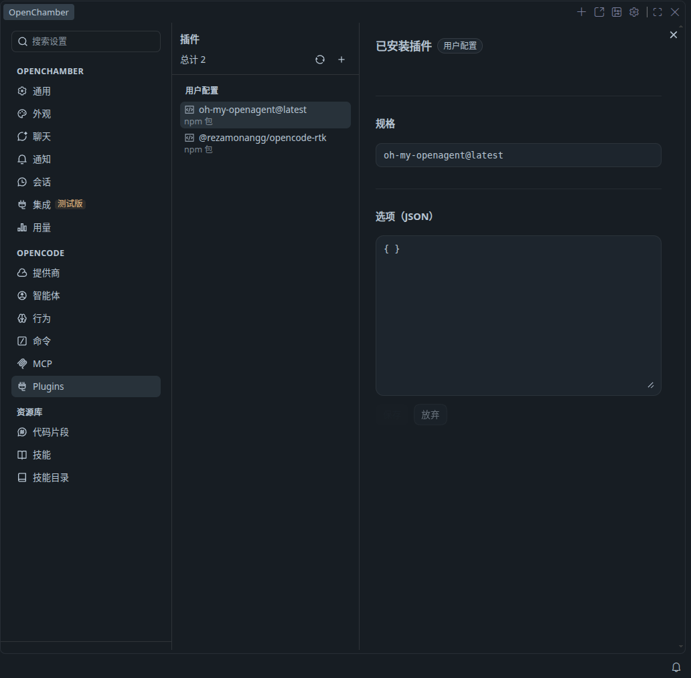

## OpenCode

需要 Node.js ≥ 20.19，用 npm 全局装：

```bash
npm install -g opencode-ai
```

不想装 Node 的话，官方也提供脚本：`curl -fsSL https://opencode.ai/install | bash`，二选一即可。本机一开始是 apt 的 Node 18，oh-my-openagent 的 ESM bin 跑不起来，升到 Node 24 LTS 后正常。

## OpenChamber

VSCode 扩展市场直接搜「OpenChamber」安装。

## oh-my-openagent

插件本体走 npm，再写进配置：

```bash
npm install -g oh-my-openagent
```

`~/.config/opencode/opencode.jsonc`：

```jsonc
{
  "$schema": "https://opencode.ai/config.json",
  "plugin": ["oh-my-openagent@latest"]
}
```

装完跑 `doctor` 验证。没有 Claude 订阅的话，主编排代理 Sisyphus 的质量会打折，它推荐 Opus 4.7。

## RTK

RTK 把 `git status` 这类命令的输出透明压缩，日常命令能省 60%~90% token。用官方脚本加自带初始化安装：

```bash
curl -fsSL https://raw.githubusercontent.com/rtk-ai/rtk/master/install.sh | sh
rtk init --opencode
```

插件会落到 `~/.config/opencode/plugins/rtk.ts`；`rtk init --show` 显示 `OpenCode: plugin installed` 即成功，`rtk rewrite` 可测重写是否生效。

## 文档

- [OpenCode](https://opencode.ai/docs)
- [OpenChamber](https://docs.openchamber.dev)
- [oh-my-openagent](https://github.com/code-yeongyu/oh-my-opencode)
- [RTK](https://github.com/rtk-ai/rtk)




