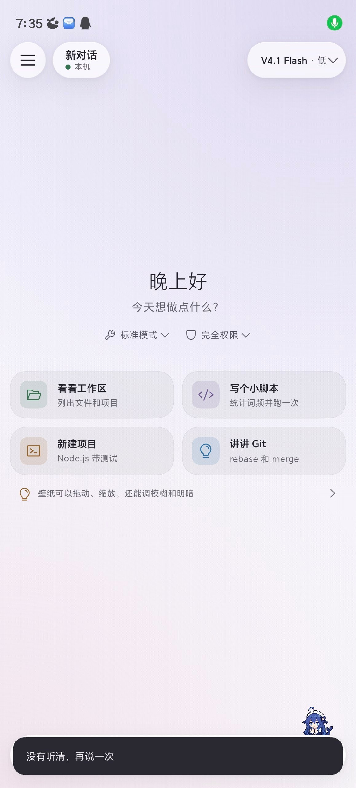

晚上躺在床上用手机语音输入，忘了开口，底部弹出来一句：

> 没有听清，再说一次

然后这条深色长条就横在屏幕最底下，把输入框整个盖住了。想再点一次麦克风重试，点不到，只能干等它自己消失——大约 4 秒。



一个很小的体验问题，但它恰好卡在"最想重试"的那一瞬间，所以还是值得报一下。

## 先查重，再开口

报 bug 之前先搜一遍，省得给维护者添重复劳动。手机上直接 `gh search issues` 按关键词组合筛："没有听清"、"语音 遮挡"、"提示条 输入框"、"SnackBar 输入框" 等等，换了十来组关键词翻了一遍。

结论是没找到同一个问题，但找到了三个附近的：

- [#8](https://github.com/ccch1mneyyy/dsh-Go/issues/8)：Fork 对话后提示条一直显示并遮挡输入框，已修复；
- [#475](https://github.com/ccch1mneyyy/dsh-Go/issues/475)：低余额胶囊出现时盖住输入条；
- [#721](https://github.com/ccch1mneyyy/dsh-Go/issues/721)：底部"思考中"胶囊遮挡正文。

第 8 条尤其重要，它说明这类问题**之前修过一次**，那我遇到的很可能是另一条没被覆盖到的路径。

## 顺手把源码读了

既然要报，就报得具体一点。让 AI 顺着仓库翻：`app/lib/ui/chat/composer.dart` 里的 `_voiceMessage()` 直接用了裸的

```dart
ScaffoldMessenger.maybeOf(context)?.showSnackBar(SnackBar(content: Text(message.text)));
```

没有 margin。而听写开始时会先 `unfocus()` 把键盘收起来，Scaffold 底部空着，这个 SnackBar 就落在最底部，正好压在 composer 上。

对比之下，fork、插入技能这些提示走的是 [`showComposerToast()`](https://github.com/ccch1mneyyy/dsh-Go/blob/main/app/lib/ui/chat/composer_toast.dart)，按 `composerHeight + safeMinimum + gap` 把提示抬到输入框上方——这正是第 8 条的修复方式。语音提示这条路没走它，所以看起来修过了，其实还漏着。

## issue 也是在手机上写完的

环境信息直接从 App 的诊断快照里抄，不用手编：

- App 1.1.0 (11150838)
- HONOR ALP-AN00 · Android 14 (SDK 34)
- 内置运行时 r15 / DSH 0.2.2-rc.1 / Node 24.22.1，proot 启动
- 连接：本机

然后 `gh issue create --body-file`，一气呵成。整个流程——复现、查重、读源码、写正文、提交——都在手机上完成，没有开电脑。

结果在这里：[#1454](https://github.com/ccch1mneyyy/dsh-Go/issues/1454)。

## 一点感受

手机上报 bug 最贵的不是"描述问题"，而是**查重和定位**。以前在手机上只能写一句"点语音没反应，还挡着输入框"，维护者还得自己复现、自己找代码；现在能先搜完 issues，再把调用链和修复方向一起贴上去，issue 的性质就从"吐槽"变成了"带定位的修复建议"。

代价是这条 issue 写得比作者修起来还长。不过想想也值——顺手给的建议是把它改成走 `showComposerToast()`，和同页面其它提示统一，改动量应该就几行。

等一个回复。
